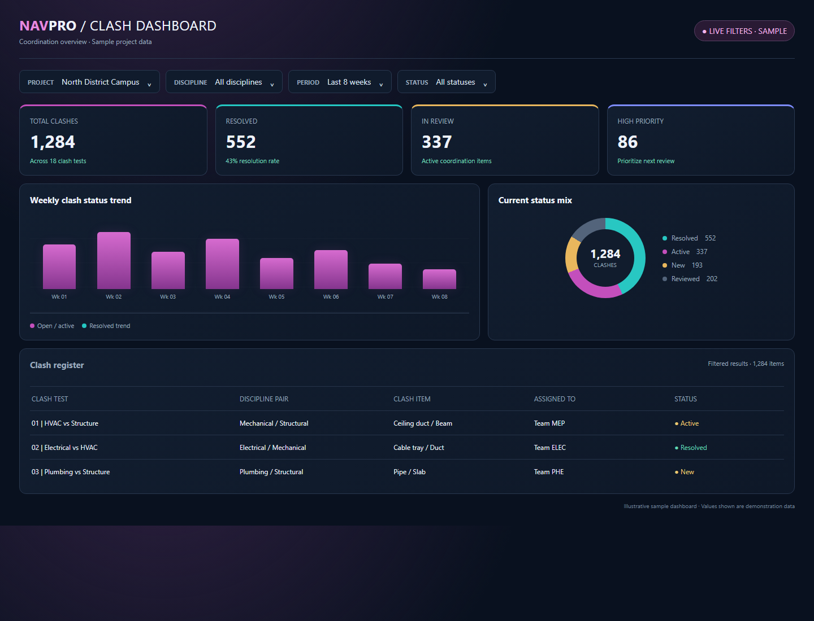

# Clash Dashboard sample output

The dashboard is exported by NavPro as a portable HTML file for browser-based review. The page brings project filters, status summaries, weekly trends, discipline coordination, and the clash register together.

> **Sample only:** the included dashboard uses illustrative project and clash data. It is not an export from a live Navisworks project.

Open the standalone [sample dashboard HTML](sample-dashboard.html) in a browser.
