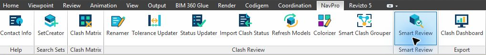
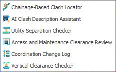

# NavPro

**A focused Navisworks Manage add-in for faster, more consistent coordination workflows.**

NavPro brings practical clash review, reporting, model inspection and selection-set tools into Navisworks Manage. It targets Navisworks Manage 2024, 2025 and 2026 with release-matched x64 .NET Framework 4.8 plug-ins.

## NavPro ribbon

Actual Navisworks Manage 2024 capture of NavPro 1.0.41 with the approved engineering icons:

The **Smart Review** dropdown keeps its six tools together:

See the [change log](CHANGELOG.md), [tool guide](Docs/TOOL-GUIDE.md) and [verification record](VERIFICATION.md). The ribbon captures confirm visible controls in Manage 2024; they do not certify every tool workflow or other host releases.

## What it helps teams do

- **Review clashes faster:** build clash matrices from saved sets, inspect dashboards and export reports.
- **Keep reviews consistent:** approve clashes, import status updates, rename tests and apply tolerance updates.
- **Manage changing models:** refresh referenced models and colorize objects for visual review.
- **Create reusable sets:** create selection/search sets from model properties and filenames.
- **Share clearer outputs:** produce structured clash reports and browser-based dashboards.

## Smart Review — version 1.0.41

Tool windows can be enlarged/maximized. Drag the dividers in Clash Matrix, SetCreator's model-file workflow, Colorizer, Status Updater, Import Clash Status and the shared Smart Review test/results views to change the space assigned to lists and previews. Double-click a divider to reset it; proportions are retained while resizing the open window.

Version 1.0.41 applies the approved CivilPro-inspired icon set to all 17 tools and the Smart Review menu. Version 1.0.40 adds stretchable Vertical Clearance source selectors, Sets/Standard/Compact source views and resizable result columns.

The six Smart Review tools are available from one compact **Smart Review ▼** dropdown in the Smart Review ribbon panel.

Review tools: Smart Clash Grouper in Clash Review; Chainage-Based Clash Locator, AI Clash Description Assistant, Utility Separation Checker, Access and Maintenance Clearance Review and Coordination Change Log in Smart Review. Read [the Smart Review workflow guide](Docs/Smart-Review.md) for supported inputs, usage and limits. The description assistant uses built-in offline drafting with three supported styles; it requires no AI setup or network connection. Alignment import supports continuous lines/circular arcs; utility and maintenance checks use the native Clash Detective engine.

Vertical Clearance Checker checks surface-to-pipe cover in world +Z only, using transformed model triangles, full-footprint coverage and explicit unverified states. Read [the workflow guide](Docs/Vertical-Clearance-Checker.md). Native extraction is available in the 2024/2026 builds; the supplied 2025 SDK folder lacks its matching COM bridge.

## Live tool checks — 23 November 2026

All 16 tools received scoped native checks in Manage 2024 on copies of the supplied federation. Version 1.0.36 fixes large status-import matching, history capacity and UI issues. Version 1.0.37 reclaims deferred native image resources between export batches and retries transient image-state failures once. The dashboard reports actual image coverage and keeps per-row errors when a capture remains unavailable. See [the tool-check report](Docs/Tool-Checks-2026-11-23.md) for native image verification, partial checks and outstanding geometry/keyboard limitations; this is not full acceptance certification.

## Showcase

See [the NavPro feature overview](Docs/Showcase/README.md) for the visual gallery and a short demo storyboard. A recorded video is not included yet.

View the existing [illustrative dashboard sample](Docs/Showcase/Dashboard/README.md). Its sample values are demonstration data.

## Compatibility

Version 1.0.39 builds against the supplied Manage 2026 API 23 assemblies and isolates each supported release in its own bundle component group. See the [2026 compatibility audit](Docs/Navisworks-2026-Compatibility.md) for evidence and native acceptance limits.

Navisworks Manage 2024, 2025 and 2026 · Windows x64 · .NET Framework 4.8. Each major release is compiled against its matching Autodesk API. Autodesk DLLs are not redistributed.

## Build and install

See [Build and share](#build-and-share) in the full documentation below for prerequisites, package creation, and installation guidance. Build with `Tools/Build-Package.ps1`; installation is a separate step. Consult the detailed [tool guide](README.md) and [verification record](VERIFICATION.md).

## Project

- [Source and issue tracker](https://github.com/rajeshpotnuru9798/NavPro---Navisworks)
- Maintainer: [@rajeshpotnuru9798](https://github.com/rajeshpotnuru9798)

---

## Renamer patterns, support details and window preferences (1.0.35)

Renamer includes three built-in naming presets and an editable custom pattern. Use {name}, {prefix}, {n}, {priority}, {a} and {b}; numbering start, step and digit padding apply to checked rows in displayed order. Preview stages names from the original names without modifying Navisworks. Discipline fields require Priority_DisciplineA_VS_DisciplineB source names. Selected-row before/after panes highlight the changed spans; duplicate/invalid names block Apply. Apply still confirms and preserves existing tests/results; source-name changes require a refresh.

Contact Info shows the loaded plug-in file version, supported Manage releases, release notes and a Diagnostics tab. Copy diagnostics copies only the displayed version/API/runtime/Windows details after a user click; no model names, file paths, account names or credentials are included.

Windows restore size, maximized state, divider proportions, existing filter text and grid column widths from per-user local preferences. Separate tools have separate profiles, including Utility Separation and Maintenance Clearance. Closed windows retain their preferences across Navisworks sessions; minimized/offscreen placements are normalized to an available monitor. Only UI preferences are stored, not model rows, test selections or service settings. Delete the corresponding JSON file under %LOCALAPPDATA%/NavPro/WindowPreferences with Navisworks closed to reset that tool's layout.

See [Review workflow enhancements 1.0.35](Docs/Review-Enhancements-1.0.35.md) for new features, input formats and outstanding geometry/native acceptance limits.

